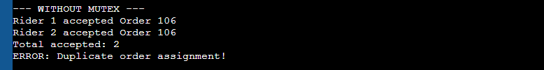
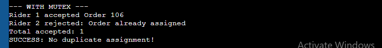
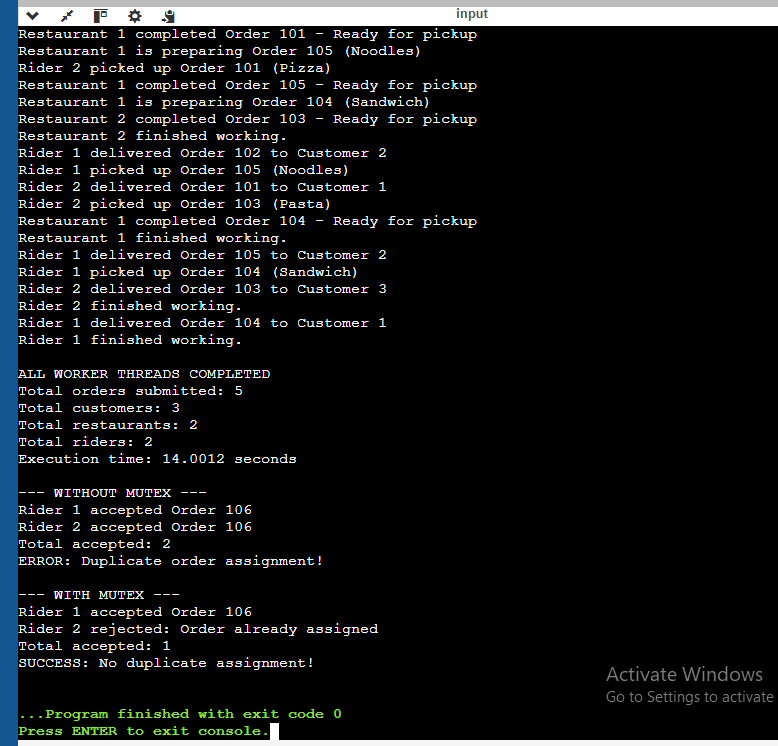

# Food Delivery Multicore System

## 1. Project Overview

The Food Delivery Multicore System is a C++20-based
multithreaded application that simulates a food delivery
platform involving customers, restaurants and delivery riders.

The project demonstrates multicore programming concepts
through a practical real-world scenario.

## 2. Project Objectives

- Implement concurrent execution using C++ threads.
- Demonstrate the producer-consumer pattern.
- Manage shared resources using synchronization.
- Demonstrate a race condition in order assignment.
- Prevent duplicate order assignment using a mutex.

## 3. Technologies Used

- C++20
- C++ Standard Thread Library
- Visual Studio Code
- OnlineGDB
- GitHub

## 4. System Architecture

Customer Threads
       |
       v
Incoming Order Queue
       |
       v
Restaurant Threads
       |
       v
Ready Order Queue
       |
       v
Delivery Rider Threads

## 5. Synthetic Dataset

| Order ID | Customer ID | Food | Cooking (ms) | Delivery (ms) |
|---|---|---|---|---|
| 101 | 1 | Pizza | 3000 | 5000 |
| 102 | 2 | Burger | 2000 | 4000 |
| 103 | 3 | Pasta | 4000 | 6000 |
| 104 | 1 | Sandwich | 2000 | 3000 |
| 105 | 2 | Noodles | 3000 | 5000 |

The project uses synthetic structured data.
No external database or dataset is required.

## 6. Phase 1 Implementation

- Three customer threads
- Two restaurant threads
- Two delivery rider threads
- Mutex-protected shared queues
- Producer-consumer pattern
- Basic pipeline processing
- Condition variables
- Controlled race condition demonstration
- Mutex-based race condition solution

## 7. Race Condition Experiment

Two riders attempt to accept the same order.

### Without Mutex

Both riders accept Order 106 because checking availability
and assigning the order are separate operations.

Atomic variables and a barrier are used to reproduce the
logical race condition without undefined behavior.

Result: Duplicate order assignment.

### With Mutex

A mutex protects the complete check-and-assign operation.

Result: Only one rider accepts the order.

## 8. Execution Results

| Metric | Result |
|---|---|
| Orders delivered | 5 |
| Customers | 3 |
| Restaurants | 2 |
| Delivery riders | 2 |
| Worker threads | 7 |
| Simulation time | 14.0012 seconds |
| Acceptances without mutex | 2 |
| Acceptances with mutex | 1 |
| Program exit code | 0 |

Execution time represents simulated processing and delivery
delays, not measured multicore CPU speedup.

## 9. Project Structure

- main.cpp
- Order.h
- OrderQueue.h
- Customer.h
- Restaurant.h
- Rider.h
- RaceCondition.h
- Screenshots/
- README.md
- .gitignore

## 10. How to Compile and Run

Compile using a compatible GCC C++20 compiler:

```bash
g++ -std=c++20 -pthread main.cpp -o FoodDeliverySystem
```

Run on Linux:

```bash
./FoodDeliverySystem
```

Alternatively, upload all seven source and header files
to OnlineGDB, select C++20 and click Run.

## 11. Execution Screenshots

### Basic Simulation


### Race Condition



### Mutex Solution



### Final Execution



## 12. Phase 2 - Future Improvements

- Priority queue
- Starvation and aging
- Semaphores
- Deadlock demonstration and prevention
- Advanced pipeline processing
- Multicore CPU speedup measurements

## 13. Conclusion

Phase 1 demonstrates concurrent food order processing
and the importance of synchronization when multiple
threads compete for shared resources.

The race condition experiment demonstrates duplicate
order assignment, while the mutex solution ensures
that only one rider can accept the order.
